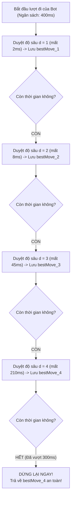

# ⏳ KỸ THUẬT TÌM KIẾM SÂU DẦN (ITERATIVE DEEPENING SEARCH)

Iterative Deepening (IDS) biến thuật toán tìm kiếm thành một **thuật toán thời gian bất kỳ (Any-time Algorithm)**, cho phép AI luôn đưa ra được nước đi tốt nhất hiện có ngay cả khi bị ngắt đột ngột bởi giới hạn thời gian.

---

## 1. NGUYÊN LÝ HOẠT ĐỘNG VÀ QUẢN LÝ THỜI GIAN (TIME BUDGET)

Thay vì đặt một độ sâu cố định (dễ dẫn tới nguy cơ treo máy ở các thế cờ nhiều nhánh), IDS lặp qua các độ sâu tăng dần:

---

## 2. NGHỊCH LÝ "CÔNG CỐC"? TẠI SAO DUYỆT NHIỀU LẦN LẠI NHANH HƠN?

Nhiều người nghĩ rằng việc duyệt lại các độ sâu $1, 2, 3$ trước khi duyệt $4$ là lãng phí tài nguyên. Tuy nhiên trong lý thuyết cây:
1. **Chi phí tầng cuối áp đảo:** Do cây phát triển theo hàm mũ với hệ số phân nhánh $b \approx 10$, số lượng nút tại độ sâu $d$ lớn gấp $10$ lần toàn bộ các tầng trước đó cộng lại:
   $$\sum_{k=1}^{d-1} b^k \approx \frac{b^d}{b - 1} \approx \frac{1}{9} b^d$$
   *(Chi phí duyệt lại chỉ tốn khoảng $11\%$ tổng thời gian!)*
2. **Hỗ trợ đắc lực cho Move Ordering:** Nước cờ tốt nhất tìm thấy ở độ sâu $d-1$ sẽ được đem ra **duyệt đầu tiên** tại độ sâu $d$. Nhờ đó, tại độ sâu $d$, Alpha-Beta kích hoạt cắt tỉa gần như tối đa ngay từ đầu!
