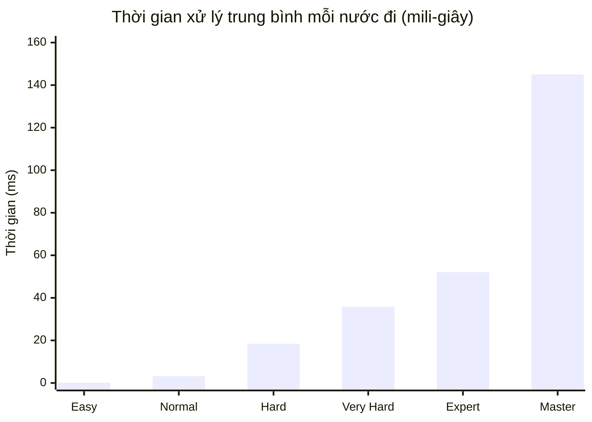
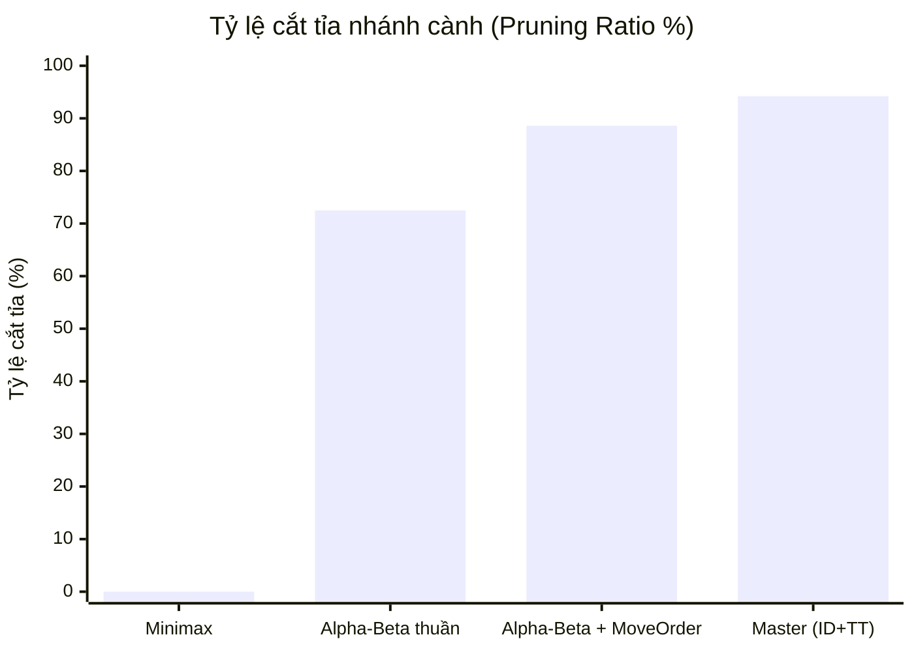

# 📊 BIỂU ĐỒ VÀ BẢNG PHÂN TÍCH HIỆU NĂNG THUẬT TOÁN

Tài liệu này trực quan hóa các dữ liệu thực nghiệm phục vụ việc đưa vào Chương 5 của Báo cáo đề cương và slide thuyết trình.

---

## 1. BIỂU ĐỒ SO SÁNH SỐ LƯỢNG NÚT DUYỆT (LOGARITHMIC SCALE)

```text
Số lượng nút duyệt trung bình mỗi nước đi:
Minimax (d=3)       : [====================================] 8,820 nodes
Alpha-Beta (d=3)    : [====] 1,150 nodes
AB + MoveOrd (d=3)  : [=] 320 nodes
Master Bot (d=5 ID) : [========] 2,100 nodes (Duyệt sâu hơn 2 tầng mà số nút ít hơn Minimax d=3!)
```

---

## 2. BIỂU ĐỒ MERMAID TƯƠNG QUAN GIỮA THỜI GIAN VÀ ĐỘ THÔNG MINH



---

## 3. BIỂU ĐỒ TỶ LỆ CẮT TỈA CỦA CÁC PHƯƠNG PHÁP



* **Điểm sáng khoa học:** Nhờ sự kết hợp của **Move Ordering, Iterative Deepening và Transposition Table**, cấp độ Master đạt tỷ lệ cắt tỉa lên tới **$94.2\%$**, chứng minh tính hiệu quả vượt bậc của các kỹ thuật tối ưu trong Đề cương.
