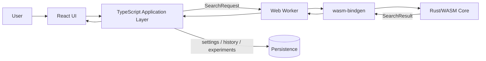
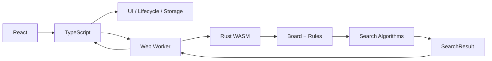

[S0] Context confidence: High

T check lại cả đề cương hiện tại + hướng Rust/WASM + tài liệu chính thức rồi. Kết luận trước để khỏi xây thêm một tầng kiến trúc chỉ vì Rust trông ngầu:

> **TS nên giữ. Rust không bắt buộc. Với project này, nếu dùng Rust thì Rust chỉ nên là computational core; TypeScript vẫn là application/browser layer.**

Quan trọng hơn: **không được biện minh “dùng Rust vì Rust nhanh hơn TypeScript” nếu chưa benchmark.** WebAssembly được thiết kế cho execution hiệu quả và có thể đạt gần native, nhưng điều đó không tự động chứng minh implementation Rust của m nhanh hơn implementation TS tương đương. ([MDN Web Docs](https://developer.mozilla.org/en-US/docs/WebAssembly/Guides/Concepts?utm_source=chatgpt.com "WebAssembly concepts - WebAssembly | MDN"))

## [S1] Problem

Đề cương ban đầu của m ghi:

```text
React
TypeScript
HTML5
CSS3

Algorithms implemented in TypeScript
```

Nhưng architecture hiện tại đang tiến thành:

```text
React + TypeScript
        ↓
     Rust/WASM
```

Nên câu hỏi thật không phải:

> Rust hay TypeScript?

Mà là:

> **Component nào nên thuộc TS và component nào đáng chuyển sang Rust?**

Nếu không phân ownership, m rất dễ có:

```text
TS checkWin()
Rust check_win()

TS heuristic()
Rust heuristic()

TS board
Rust board
```

và rồi hai engine cùng tin rằng mình là nguồn chân lý. Một project Caro với hai chính phủ.

---

# [S2] Definitions

**TypeScript**

= JavaScript có static type checking trước khi chạy.

TypeScript không tạo một runtime riêng. Sau khi type-check, type information bị loại bỏ và code vẫn chạy theo JavaScript runtime semantics. ([TypeScript](https://www.typescriptlang.org/docs/handbook/intro?utm_source=chatgpt.com "TypeScript: Handbook - The TypeScript Handbook"))

Vai trò phù hợp:

```text
React
DOM/browser API
UI state
game lifecycle
Web Worker orchestration
fetch/API
localStorage/IndexedDB
Rust/WASM integration
```

---

**Rust computational core**

= module chỉ tập trung tính toán domain/algorithm, không sở hữu React UI.

Ví dụ:

```text
Board representation
RuleSet
Win detection

Pattern Detection
Heuristic

Minimax
Alpha-Beta
Candidate Generation
Move Ordering
Iterative Deepening
Transposition Table
Zobrist Hashing
```

---

**WebAssembly (Wasm)**

= binary instruction format mà Rust có thể compile sang để chạy trong browser.

Wasm được thiết kế để **bổ sung cho JavaScript**, không thay thế JavaScript. WebAssembly.org và MDN đều mô tả mô hình JS + Wasm cùng tồn tại. ([WebAssembly](https://webassembly.org/docs/faq/?utm_source=chatgpt.com "FAQ - WebAssembly"))

---

**wasm-bindgen**

= bridge giữa Rust/Wasm và JavaScript.

Nó cho phép export Rust functions/classes sang JS và hiện còn có thể tạo TypeScript bindings cho Rust API. ([Wasm Bindgen](https://wasm-bindgen.github.io/wasm-bindgen/?utm_source=chatgpt.com "Introduction - The `wasm-bindgen` Guide"))

---

# [S3] System map đúng

Nếu giữ cả hai ngôn ngữ, t sẽ khóa boundary như này:



Single source of truth chia theo trách nhiệm:

```text
Browser/application lifecycle
→ TypeScript

Algorithm/search computation
→ Rust

Rendered UI
→ React

Persistent records
→ TS data layer
```

Đừng để Rust tự đi fetch MockAPI, sửa DOM, quản lý modal rồi tiện thể chạy Minimax luôn. Có thể làm được không có nghĩa là nên làm. `web-sys` thực tế cho Rust access Web APIs như `fetch`, WebGL... nhưng đó là capability, không phải lời mời biến frontend thành một cuộc thi chịu đựng. ([Wasm Bindgen](https://wasm-bindgen.github.io/wasm-bindgen/web-sys/index.html?utm_source=chatgpt.com "web-sys - The `wasm-bindgen` Guide"))

---

# [S4] Vì sao nên dùng TypeScript?

Ở project này, **TS có lý do tồn tại rất rõ**.

### 1. React/web ecosystem nằm tự nhiên ở JS/TS

React application của m cần xử lý:

```text
click
difficulty
game mode
screen
modal
button
responsive UI
fetch
storage
worker
```

Đây là domain mà JavaScript/TypeScript sinh ra để xử lý.

Wasm bản thân cũng được thiết kế để integrate với JS, không phải thay toàn bộ web application. ([MDN Web Docs](https://developer.mozilla.org/en-US/docs/WebAssembly/Guides/Concepts?utm_source=chatgpt.com "WebAssembly concepts - WebAssembly | MDN"))

### 2. TS giúp khóa contract

Ví dụ:

```ts
interface SearchRequest {
    board: number[];
    currentPlayer: Player;
    difficulty: Difficulty;
    ruleSetVersion: string;
}

interface SearchResult {
    bestMove: Move;
    score: number;
    stats: SearchStats;
}
```

Sai kiểu:

```ts
result.bestMvoe
```

hoặc truyền:

```ts
currentPlayer: "banana"
```

thì TypeScript có thể bắt trước runtime.

Đó chính là mục tiêu chính thức của TypeScript: static checking trước khi chương trình chạy. ([TypeScript](https://www.typescriptlang.org/docs/handbook/intro?utm_source=chatgpt.com "TypeScript: Handbook - The TypeScript Handbook"))

### 3. Rust ↔ JS boundary lại càng cần TS

Có một nghịch lý khá đẹp:

> càng thêm Rust thì càng cần contract phía TypeScript rõ.

Vì bây giờ có:

```text
Browser
↓
TS
↓
Worker
↓
WASM
↓
Rust
```

Mỗi boundary là nơi dữ liệu có thể sai shape.

`wasm-bindgen` thậm chí hỗ trợ sinh TypeScript bindings từ Rust exports, nên ecosystem này được thiết kế để hai bên cộng tác. ([Wasm Bindgen](https://wasm-bindgen.github.io/wasm-bindgen/?utm_source=chatgpt.com "Introduction - The `wasm-bindgen` Guide"))

---

# [S5] Vậy tại sao dùng Rust?

Đây mới là chỗ cần cẩn thận.

## Lý do 1: Search của Caro là computational workload

Minimax tạo dạng:

T≈bdT \approx b^d

Trong đó:

- bb = branching factor, số nước đi được xét tại mỗi state.
    
- dd = search depth.
    

Ví dụ đơn giản:

```text
20 candidates
depth 5

≈ 20⁵
≈ 3,200,000
```

trước pruning.

Đây không còn là UI logic nữa. Nó là:

```text
generate
→ mutate board
→ evaluate
→ recurse
→ undo
→ repeat hàng triệu lần
```

Rust phù hợp với kiểu workload này vì có explicit data structures, memory layout control và không có garbage collector trong Rust runtime.

Rust/Wasm documentation cũng nêu low-level control và predictable-performance characteristics là một động lực sử dụng Rust với Wasm. ([Rust and WebAssembly](https://rustwasm.github.io/docs/book/why-rust-and-webassembly.html?source=post_page---------------------------&utm_source=chatgpt.com "Why Rust and WebAssembly? - Rust and WebAssembly"))

Nhưng nguồn Rust/Wasm cũ đó hiện ghi rõ website không còn maintained, nên t chỉ coi nó là background rationale, **không dùng làm bằng chứng rằng project của m chắc chắn nhanh hơn**.

---

## Lý do 2: Board representation có thể compact hơn

Ví dụ Rust:

```rust
struct Board {
    cells: [i8; 225],
}
```

15 × 15:

```text
225 cells
```

Search có thể:

```text
play
→ recurse
→ undo
```

trên một cấu trúc cố định.

Điều này rất phù hợp với engine search.

Không có nghĩa TypeScript không làm được typed arrays. Nó làm được.

Do đó đây là:

**[C] Engineering rationale**, không phải proof Rust thắng.

---

## Lý do 3: Algorithm isolation

Rust crate có thể thành pure engine:

```text
Input:
GameState

Process:
search()

Output:
SearchResult
```

Không phụ thuộc:

```text
React
DOM
CSS
localStorage
network
```

Điều này rất tốt cho:

```text
unit test
benchmark
fixture
reproducibility
```

Và nó hợp với đồ án thiên về **phân tích thuật toán** của m hơn việc dành 20 trang luận văn mô tả nút Start Game có border-radius bao nhiêu.

---

# [S6] Nhưng Rust đem thêm chi phí gì?

Khá nhiều. Rust không phải viên đá triết gia.

|Vấn đề|TypeScript-only|TS + Rust/WASM|
|---|---|---|
|Architecture|đơn giản|phức tạp hơn|
|Build|Vite/TS|thêm Cargo + wasm-bindgen|
|Debug|một runtime chính|JS + Worker + Wasm|
|Data boundary|ít|phải serialize/convert|
|State duplication risk|thấp hơn|cao nếu design tệ|
|Test infrastructure|đơn giản|TS + Rust + integration|
|Learning cost|thấp|cao hơn|
|Algorithm isolation|được|rất rõ nếu làm đúng|
|Potential compute optimization|tốt|có thêm low-level control|
|Research value|đủ|cao hơn nếu benchmark chuẩn|

Đặc biệt có **boundary cost**.

JS gọi Wasm và Wasm gọi JS không hoàn toàn miễn phí. Tài liệu wasm-bindgen còn có riêng benchmark để quan sát cost của việc crossing JS/Wasm boundary; MDN cũng mô tả một số bridge/import operation có overhead. ([MDN Web Docs](https://developer.mozilla.org/en-US/docs/WebAssembly/Guides/JavaScript_builtins?utm_source=chatgpt.com "WebAssembly JavaScript builtins - WebAssembly | MDN"))

Do đó đừng thiết kế:

```text
TS → Rust evaluateCell()
TS → Rust evaluateCell()
TS → Rust evaluateCell()
x 1,000,000
```

Nên:

```text
TS
↓
search(request)
↓
Rust xử lý cả search
↓
result
```

Một coarse-grained call.

---

# [S7] Có thực sự cần Rust không?

**Không.**

Đây là điểm quan trọng nhất.

Proposal gốc của m hoàn toàn có thể hoàn thành bằng TypeScript:

```text
Random
Heuristic
Minimax
Alpha-Beta
Candidate generation
Move ordering
Iterative deepening
TT
Zobrist
```

không có thuật toán nào trong số đó bắt buộc Rust.

Nếu mục tiêu chỉ là:

> hoàn thành Basic Project đúng scope, dễ maintain, 10 tuần

thì:

```text
React + TypeScript
```

là một architecture hợp lệ và đơn giản hơn.

---

Nhưng nếu research question có thêm:

> Có nên tách computational search core khỏi web application?

hoặc:

> Rust/WASM có đem lại lợi ích gì cho search workload này so với TypeScript dưới cùng algorithm/configuration?

thì Rust trở thành một phần nghiên cứu có lý do.

Và lúc đó phải benchmark:

```text
same board
same rule
same candidates
same heuristic
same ordering
same depth
same machine/browser
same number of runs

TS implementation
vs
Rust/WASM implementation
```

rồi mới nói cái nào nhanh.

MDN chỉ support claim chung rằng Wasm được thiết kế cho efficient/near-native execution và complement JavaScript. Nó **không support claim “Rust Caro của m nhanh hơn TS Caro”**. ([MDN Web Docs](https://developer.mozilla.org/en-US/docs/WebAssembly/Guides/Concepts?utm_source=chatgpt.com "WebAssembly concepts - WebAssembly | MDN"))

---

# [S8] Recommendation

### [D] Recommended approach cho project hiện tại

**Giữ TypeScript.**

Không có lý do hợp lý để bỏ TS.

Kiến trúc:

```text
React
+
TypeScript Application Layer
+
Rust/WASM Computational Core
```

Cụ thể:

```text
TypeScript owns
├─ React UI
├─ game screen lifecycle
├─ player input
├─ pause/reset/new game
├─ worker lifecycle
├─ stale-result protection
├─ storage
├─ API
└─ Rust adapter


Rust owns
├─ Board computational representation
├─ RuleSet
├─ Pattern Detection
├─ Evaluation
├─ Candidate Generation
├─ Minimax
├─ Alpha-Beta
├─ Move Ordering
├─ Iterative Deepening
├─ Zobrist
├─ Transposition Table
└─ SearchStats
```

Nhưng có một điều kiện:

> **Rule logic không được tồn tại độc lập ở cả TS và Rust.**

Nếu Rust trở thành canonical core, TypeScript không nên duy trì thêm một implementation heuristic/minimax thứ hai chỉ để “backup”.

---

# [S9] Cách giải thích trong báo cáo sau này

Đừng viết:

> “Rust được sử dụng vì nhanh hơn TypeScript.”

Chưa chứng minh.

Viết logic khoa học hơn:

```text
Original proposal
→ TypeScript implementation

Architecture analysis
→ search algorithms form an isolated,
   computation-intensive subsystem

Design evolution
→ React/TypeScript retained for
   browser-facing application logic

→ Rust/WASM introduced as
   computational core

Experiment
→ compare equivalent implementations

Result
→ only then conclude performance difference
```

Tức là architecture cuối của m có thể cô đọng thành:



**Chốt:** TypeScript không những nên dùng mà gần như là layer tự nhiên nhất cho React/browser của project này. Rust chỉ đáng giữ ở phần computational core. Còn lý do dùng Rust phải là **isolation + low-level control + hypothesis về search performance cần được benchmark**, không phải “Rust nhanh nên dùng”. Nếu m không định benchmark hoặc Rust làm trễ scope, TypeScript-only vẫn đáp ứng đề cương tốt hơn và ít rủi ro hơn.