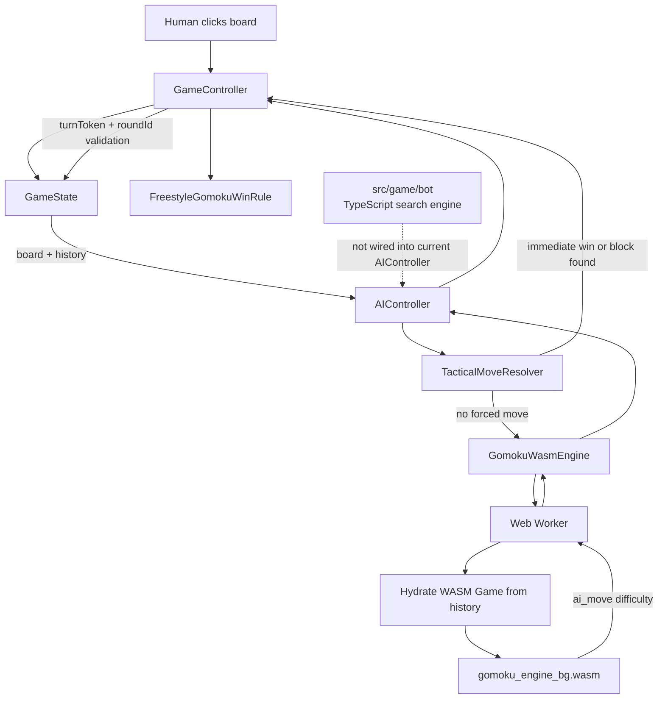
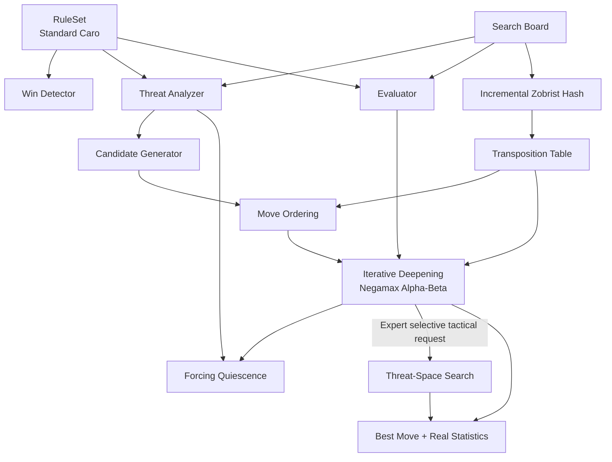

# Caro AI Research Baseline and Algorithm Research Program

## Context and problem framing

**[S0] Context confidence: Medium–High**

The uploaded Repomix is sufficient to establish the architecture, game-state ownership, visible rule implementation, AI orchestration, the complete TypeScript search engine, difficulty contracts, tests, and the production WebAssembly boundary. It is **not sufficient to establish what algorithm the production WASM engine actually executes**, because the repository contains the generated JavaScript bindings, TypeScript declarations, and compiled `.wasm` artifact, but not the Rust source from which that binary was built. fileciteturn0file0

That distinction is the central finding of this first research pass:

> **The repository contains a researchable TypeScript Gomoku engine, but the application currently routes strategic AI decisions through a different, opaque WASM engine.**

Therefore, we can already research the rules, architecture, TypeScript algorithm, likely optimization opportunities, experimental methodology, and algorithmic alternatives with high confidence. We cannot yet make defensible claims such as “the production AI uses alpha–beta at depth 6” or “the production AI uses a transposition table” unless the missing Rust engine source is supplied. fileciteturn0file0

**[S1] Problem**

**Symptom.** The project is presented to the player as **Cờ Caro / Gomoku**, contains a sophisticated game-search implementation, and exposes several AI difficulty levels, but the repository currently has three important ambiguities: the implemented winning rule is Freestyle Gomoku rather than the standard Caro rule used by Gomocup; the sophisticated TypeScript search engine does not appear to be the production engine; and the production WASM engine does not expose enough source or telemetry to prove its algorithmic behavior. fileciteturn0file0

**Expected.** For an academically defensible Basic Project, there should be a traceable chain:

```text
Declared Caro rules
→ rule implementation
→ threat definitions
→ evaluation function
→ move generation
→ search algorithm
→ difficulty policy
→ measurable search statistics
→ experiments
→ report claims
```

**Actual.** The visible game rule declares a win when a line has **at least five stones**, while the official Gomocup “standard caro” rule requires **exactly five stones and the line must not be blocked at both ends**. Gomocup explicitly distinguishes Freestyle, where five or more wins, from Standard, where exactly five wins, and Caro, where exactly five is required and a sequence such as `oxxxxxo` or `xxxxxx` is not a win for X. citeturn11search1 The repository's `FreestyleGomokuWinRule` accepts `cells.length >= 5`, and the tactical win detector independently applies the same `count >= 5` rule. fileciteturn0file0

That means the most important question is currently not “how do we make minimax deeper?” It is:

> **What exact game are we trying to build and evaluate?**

Until that is fixed, deeper search can make the AI better at the **wrong game**.

**Impact.** Rule semantics affect far more than the final winner check. They determine whether an overline is valuable, whether a five blocked at both ends is terminal, which candidate moves are considered forcing, how OPEN FOUR / FOUR / THREE patterns are evaluated, how a tactical solver proves wins, and what benchmark positions count as correct. Gomocup still operates a dedicated Caro league under the standard Caro rule in 2026, so this is not merely terminological. citeturn11search12turn11search1

**Scope of this research.** The core scope is:

```text
Rule correctness
→ board representation
→ tactical detection
→ candidate generation
→ evaluation
→ game-tree search
→ pruning / ordering / caching
→ forcing search
→ difficulty scaling
→ benchmarking
```

React, PixiJS, leaderboard integration, styling, and deployment are out of scope except where they interact with AI lifecycle, cancellation, responsiveness, or reproducibility. The “system thinking” approach remains an internal analysis method; it should **not** become a chapter or methodology label in the academic report unless the university explicitly requires it.

## Definitions and algorithm foundations

**[S2] Definitions**

### Caro, Standard Gomoku, and Freestyle Gomoku

These terms must not be treated as synonyms in the report.

**Freestyle Gomoku**  
= a continuous line of five **or more** stones wins.

**Standard Gomoku**  
= exactly five stones wins; an overline does not.

**Standard Caro**, in the Gomocup definition  
= exactly five consecutive stones, and the line cannot be blocked at both ends. Gomocup uses a 15×15 board for this rule. citeturn11search1turn11search2

The current repository implements the first definition: Freestyle Gomoku. The board is already 15×15, but both `FreestyleGomokuWinRule` and the immediate tactical resolver accept five or more. fileciteturn0file0

This should become the **first formal specification decision** in the project.

### Negamax and alpha–beta search

**Negamax**  
= a compact form of minimax for zero-sum games. Instead of having separate maximizing and minimizing functions, each side treats the position from its own perspective:

\[
V(s) = \max_{m \in M(s)} -V(s_m)
\]

where:

- \(s\) = current board state,
- \(M(s)\) = legal/candidate moves,
- \(m\) = one candidate move,
- \(s_m\) = state after move \(m\),
- \(V(s)\) = estimated value for the side to move.

The TypeScript engine uses precisely this pattern when it recursively calls:

```text
score = -alphaBeta(child, -beta, -alpha, ...)
```

fileciteturn0file0

**Alpha–beta pruning**  
= minimax/negamax search that tracks bounds \(\alpha\) and \(\beta\) and stops exploring a branch when it cannot affect the final decision. Knuth and Moore's classic analysis established the correctness of alpha–beta and analyzed its search cost under different conditions. The effectiveness depends strongly on the order in which moves are searched, which is why move ordering is a first-class optimization rather than decorative polish. citeturn10search2

In this project, alpha–beta is already implemented in the TypeScript engine together with move sorting, transposition-table move priority, iterative deepening, and beta cutoffs. fileciteturn0file0

### Iterative deepening

**Iterative deepening**  
= search depth 1, then depth 2, then depth 3, and so on until the time budget or maximum depth is reached.

Its role here is especially useful in a browser game because a difficulty can be controlled by time rather than by assuming a fixed depth is always affordable:

```text
depth 1 finishes
→ save best move
→ depth 2 finishes
→ replace best move
→ depth 3 starts
→ timeout
→ return depth-2 result
```

The TypeScript engine already follows this structure and preserves the last completely searched move when a deeper iteration aborts. fileciteturn0file0

### Transposition table

**Transposition**  
= the same board position reached through different orders of moves.

**Transposition table**  
= a cache indexed by a board hash, storing information such as:

```text
position hash
search depth
score/bound
best move
```

The TypeScript engine has a direct-mapped table with 1,000,003 slots and stores an EXACT, LOWER, or UPPER bound plus the preferred move. fileciteturn0file0

### Zobrist hashing

**Zobrist hashing**  
= an incremental hashing technique for board-game states in which random bit strings are associated with piece-square combinations and XOR is used to update the position hash as moves are made or undone. Zobrist originally described the method for game-playing programs including checkers, chess, and Go. citeturn10search1turn10search0

The TypeScript board maintains two 32-bit Zobrist components and updates them incrementally during `makeMove()` and `undoMove()`. fileciteturn0file0

### Quiescence search

**Quiescence search**  
= when normal search reaches its nominal depth limit, do not immediately evaluate positions that are tactically unstable. Continue exploring a restricted set of forcing moves until the position becomes quieter or another selective limit is reached.

The TypeScript engine implements this concept with a maximum quiescence depth of five and only generates moves classified as forcing. fileciteturn0file0

Its intended role is to reduce a classic horizon problem:

```text
depth limit
   ↓
"position looks good"
   ↓
opponent has forced four just beyond horizon
   ↓
static evaluator gives misleading score
```

### Threat-space search

**Threat-space search**, or TSS  
= a selective search specialized around forcing threats rather than exploring a conventional full-width game tree.

This technique is particularly relevant to Gomoku. Allis and colleagues' program Victoria combined **threat-space search** with **proof-number search**, and their 1996 paper specifically focuses on threat-space search and its advantages relative to conventional search. citeturn10search3

This is not merely historical trivia. Modern Gomocup materials still describe competitive engines that combine alpha–beta, iterative deepening, transposition-table techniques, and specialized VCF/VCT forcing searches; for example, the official Gomocup download page describes the 2023 Squirrel engine in those terms and notes later support for Standard and Caro rules. citeturn11search5

### Proof-number search

**Proof-number search**, or PNS  
= an AND/OR-tree search designed to prove or disprove a game-theoretic result rather than merely estimate a heuristic minimax score.

The original PNS work explains that the algorithm selects nodes based on the number of leaves needed to prove or disprove a result, and reports its application to games including Go-Moku. citeturn10search5 Later work from the Maastricht group also reports PNS applied successfully to Go-Moku and discusses its interaction with transpositions. citeturn11search3

For this project, PNS is better viewed as an **advanced tactical solver or future-work candidate**, not the first thing to implement.

The hierarchy should be:

```text
correct rules
→ efficient alpha-beta backbone
→ tactical selectivity
→ threat-space search
→ only then consider proof-number solving
```

## Current system flow and source baseline

**[S3] Current system flow**

The repository's current runtime flow is:



The important ownership boundaries are already reasonably clean. `GameState` owns the board/history, `MatchController` owns round phase/difficulty/round identity, `GameController` owns turn lifecycle and stale-result prevention, and `GomokuWasmEngine` owns the worker lifecycle. AI results are checked against a turn token, round ID, pause state, game phase, mode, and current player before being committed. fileciteturn0file0

That is good architecture. The problem is not primarily lifecycle ownership. The problem lies in **algorithm and rule ownership**.

### Project facts

| Area | [A] Source fact | Research consequence |
|---|---|---|
| Board | Fixed 15×15 board | Matches Gomocup Caro board size, but board size alone does not make the game Caro. |
| Win check | `FreestyleGomokuWinRule`, `>= 5` | Implements Freestyle semantics. |
| Immediate AI tactics | Scans empty cells; immediate win first, then immediate block | Correct strategic priority in principle, but uses the same freestyle `>=5` semantics. |
| Production strategy | `AIController → GomokuWasmEngine → worker → Game.ai_move()` | Actual search algorithm is hidden inside WASM. |
| TypeScript bot | Contains alpha–beta, iterative deepening, quiescence, TT, Zobrist, move ordering | Strong research material, but presently not the production path. |
| Candidate generation | Nearby cells plus forcing moves | Sensible search-space reduction, but computationally expensive implementation. |
| Evaluation | FIVE, OPEN_FOUR, FOUR, OPEN_THREE, BROKEN_THREE | Useful initial model but currently aligned to Gomoku patterns, not verified Caro semantics. |
| Difficulty | Multiple independent maps/contracts | No single measurable source of truth. |
| AI telemetry | WASM returns elapsed time; wrapper reports `nodes = 0` and mapped depth | Cannot currently benchmark actual WASM nodes or true completed depth. |
| Tests | Core rules, lifecycle, Pixi, WASM contract | Missing tactical/search/strength/Caro-rule test suites. |

All of these facts are directly present in the supplied repository representation. fileciteturn0file0

### The production engine and the TypeScript engine are not the same path

The production `AIController` imports:

```text
GomokuWasmEngine
findForcedTacticalMove
```

and calls the WASM engine after the tactical pre-check. The `GomokuEngine` defined in `src/game/bot/index.ts` is not imported by `AIController`, while `findBestMove()` is only used by `src/game/bot/worker.ts`. `SearchPositionBuilder`, which would prepare a position for that TypeScript bot, also has no visible production caller in the packed source. fileciteturn0file0

Therefore:

**[A] Proven**

```text
Production strategic engine = WASM
```

**[A] Proven**

```text
A complete TypeScript alpha-beta engine exists.
```

**[C] Strong inference**

```text
src/game/bot is currently legacy/reference/disconnected code,
rather than the runtime AI.
```

This distinction is essential for the thesis. It would be academically unsafe to describe `src/game/bot/search.ts` and then imply that this is what the shipped application executes.

### The WASM depth statistics are not actual measured depth

The WASM worker calls:

```text
game.ai_move(WASM_DIFFICULTIES[difficulty])
```

and then constructs the result:

```text
depth: WASM_SEARCH_DEPTHS[difficulty]
nodes: 0
```

Thus the visible `depth` field is supplied by a static TypeScript mapping; it is not returned by the WASM search. Likewise `nodes` is always zero in that path. fileciteturn0file0

Consequently, a report must **not currently claim**:

> “Expert AI searched exactly six plies.”

The defensible statement is:

> “The wrapper associates Expert with the value six in its telemetry contract; the actual completed search depth is not exposed by the compiled WASM API.”

### Difficulty is currently fragmented

There are at least three difficulty-related definitions.

The general AI contract defines:

```text
easy   = 50 ms,   depth 2
normal = 150 ms,  depth 4
hard   = 500 ms,  depth 8
expert = 1200 ms, depth 64
master = 1800 ms, depth 64
```

The WASM wrapper separately declares:

```text
easy   → 0 / reported depth 1
normal → 1 / reported depth 2
hard   → 2 / reported depth 4
expert → 3 / reported depth 6
master → 4 / reported depth 8
```

and the user interface exposes only:

```text
easy
normal
hard
expert
```

not `master`. fileciteturn0file0

There is even a stale-looking test whose expected objects stop at Expert while the implementation now contains Master. This analysis does **not** claim that the test was executed and failed; it only establishes that the packed source's expectation and implementation are inconsistent. fileciteturn0file0

Difficulty therefore needs to become an **experimentally calibrated behavior**, not merely a collection of hard-coded labels.

## Root cause and algorithm audit

**[S4] Root cause**

The root-cause chain is:

```text
SYMPTOM
"Caro" AI behavior and report claims are difficult to prove
        ↓
IMMEDIATE CAUSES
Rule says >=5
Production search is opaque WASM
Legacy TS search remains beside WASM
Difficulty definitions are duplicated
Telemetry is partly synthetic
        ↓
SYSTEM CAUSE
No single shared contract owns:
rules + threats + engine + difficulty + metrics
        ↓
ROOT CAUSE
The project evolved across multiple AI/rule implementations
without consolidating one authoritative algorithmic source of truth
```

The largest danger is therefore **not simply “search is too slow.”**

The largest danger is:

> **the thesis may end up explaining one engine, testing another engine, and calling a third rule set “Caro.”**

### Rule mismatch is upstream of every AI optimization

The official Gomocup Caro definition requires an unbroken **exactly-five** line that is not blocked at both ends. The existing implementation accepts five or more. citeturn11search1 fileciteturn0file0

This changes tactical truth.

Consider:

```text
X X X X X X
```

Under the repository's current win checker:

```text
WIN
```

Under Gomocup Standard Caro:

```text
NOT A WIN
```

Likewise:

```text
O X X X X X O
```

is currently recognized by the generic length test as a five, while Gomocup explicitly gives this as a non-winning pattern for X. citeturn11search1

So an evaluator that awards a huge score to every `FIVE` pattern is not automatically valid for Caro. Threat classification must understand rule semantics.

### The TypeScript engine is already more advanced than a plain minimax implementation

Calling the existing TypeScript code “minimax” would undersell it. Its actual design includes:

```text
iterative deepening
    +
negamax alpha-beta
    +
transposition table
    +
Zobrist hashing
    +
hash-move ordering
    +
heuristic move ordering
    +
candidate locality filtering
    +
forcing-move generation
    +
quiescence search
    +
incremental make/unmake
```

fileciteturn0file0

That is already a legitimate research platform. The research problem should therefore not be framed as “implement minimax.” It should be framed more strongly:

> **How can a bounded tactical game-tree search for 15×15 Caro be made rule-correct, selective, measurable, and strong under an interactive time budget?**

That is a much better Basic Project research question.

### Candidate generation is a likely performance hotspot

The TypeScript `generateCandidates()` first scans the whole board to identify empties and occupied bounds. For each potential candidate, it can perform a move/unmove cycle for the current player and another temporary move/unmove sequence to test the opponent's forcing potential. It then performs an additional local-neighbor check. fileciteturn0file0

Each `makeMove()` / `undoMove()` updates affected lines for both players. The search source itself even contains a comment noting that nodes are expensive because candidate generation performs many make/unmake operations. fileciteturn0file0

This suggests a more precise optimization target than “reduce objects”:

```text
CURRENT
every search node
→ rescan board
→ gather empties
→ simulate many empties
→ recompute changed-line patterns repeatedly

TARGET
maintain frontier incrementally
→ only inspect plausible nearby cells
→ use local threat delta
→ avoid simulation where a local pattern query is sufficient
```

The performance hypothesis should be benchmarked, not assumed.

### Evaluation appears to duplicate work

`BotBoard` maintains exact-looking pattern-count arrays and updates the four affected directions incrementally after a move. Yet `evaluatePosition()` independently scans horizontal, vertical, and diagonal lines again to reconstruct pattern counts. fileciteturn0file0

This creates a promising research question:

> Can the incremental pattern state become the evaluation source of truth so that leaf evaluation becomes approximately constant-time with respect to board area?

However, this change must **not** be performed blindly. The current line classifier records a coarse pattern category per segment rather than necessarily enumerating every tactical subpattern, so first we must prove that `board.counts` and `evaluatePosition()` represent equivalent semantics for the intended evaluator.

The correct procedure is:

```text
instrument both evaluators
→ generate thousands of legal positions
→ compare pattern counts / scores
→ identify semantic differences
→ redesign if intentional
→ only then replace full-board evaluation
```

### Move ordering is already correctly treated as a major concern

The TypeScript engine gives the transposition table's previous best move extremely high move-ordering priority and heuristically scores the remaining moves before search. fileciteturn0file0

That architectural choice is well supported by the theory of alpha–beta pruning: alpha–beta's practical efficiency depends heavily on the sequence in which moves are examined, because good moves produce earlier bounds and therefore more cutoffs. Knuth and Moore's analysis is foundational evidence for treating ordering as an algorithmic optimization rather than a cosmetic one. citeturn10search2

The relevant experiment is therefore not:

> “Does alpha-beta work?”

but:

> “How many nodes are eliminated by each ordering layer?”

For example:

```text
unordered
vs
static heuristic ordering
vs
TT move + static ordering
vs
TT + tactical priority + history/killer heuristic
```

### Zobrist + transposition table is justified, but the implementation needs instrumentation

Zobrist hashing is a standard incremental board-hashing method originating in game-playing research, and the current implementation is structurally appropriate for repeated make/unmake search. citeturn10search1 fileciteturn0file0

What is currently missing is evidence about its actual benefit.

The search should expose at least:

```text
ttProbes
ttHits
ttExactHits
ttCutoffs
ttStores
ttCollisions/replacements
hashMoveFirstCount
```

Without these measurements, the report can explain what a transposition table is, but it cannot prove how much this project's table helps.

### A transposition-table correctness point requires verification

**[C] Inference, not a confirmed bug.**

The TypeScript search encodes mate distance with values such as:

```text
-MATE_SCORE + ply
```

and stores scores in a global transposition table that persists across calls. fileciteturn0file0

Within one root search, the same exact board position typically has the same stone count and therefore the same root-relative ply. Across **different root searches**, however, a cached mate score may have been computed relative to an earlier root.

A robust investigation should therefore test either:

```text
clear/age TT between root searches
```

or

```text
normalize mate scores when writing/reading TT entries
```

before relying on mate-distance ordering across turns.

This is a hypothesis generated from the source structure, not yet a demonstrated defect.

### TacticalMoveResolver is logically useful but algorithmically blunt

The production AI first enumerates every empty cell, checks whether the AI can win there, and then repeats the conceptual process for the opponent. On a 15×15 board this is bounded and perfectly acceptable for correctness, but it duplicates threat semantics outside the strategic engine. fileciteturn0file0

The architectural issue is more important than the raw runtime:

```text
WinRule defines win
TacticalMoveResolver defines win again
WASM engine almost certainly defines win again
TS bot defines FIVE again
```

This violates the desired single-source-of-truth property.

Under Freestyle they may agree today.

Under Standard Caro they can easily diverge.

## Evidence, unknowns, and research questions

**[S5] Evidence/docs**

The evidence status after this research pass is:

| Evidence | Status | What it proves |
|---|---|---|
| Uploaded Repomix | **VERIFIED** | Architecture, rules, TS bot, WASM wrapper, tests, difficulty contracts. fileciteturn0file0 |
| Gomocup rule documentation | **VERIFIED / FETCHABLE** | Formal distinction among Freestyle, Standard, Renju, and Caro; Caro uses exact five, not blocked both ends, 15×15. citeturn11search1 |
| Gomocup current tournament data | **VERIFIED / FETCHABLE** | Dedicated Caro competition is still active; 2026 uses Elo and explicit resource/time constraints. citeturn11search12 |
| Knuth & Moore alpha–beta paper | **VERIFIED / FETCHABLE metadata + abstract** | Correctness and analysis of alpha–beta pruning. citeturn10search2 |
| Zobrist technical report | **VERIFIED / FETCHABLE repository record** | Original hashing method for game-playing applications. citeturn10search1 |
| Allis et al. Go-Moku paper | **VERIFIED / FETCHABLE abstract** | Victoria; TSS + PNS; Go-Moku solving research. citeturn10search3 |
| Original PNS paper | **VERIFIED / FETCHABLE abstract** | PNS objectives and application to Go-Moku. citeturn10search5 |
| Allis PhD thesis metadata | **VERIFIED** | 1994 Maastricht thesis, 207 pages, DOI and official full-text entry. citeturn12view0 |
| Allis thesis PDF body | **FETCH BLOCKED IN THIS SESSION** | The official page exposes a Full Text entry, but the fetch returned HTTP 403. citeturn13view0 |
| Production Rust source | **MISSING FROM PROVIDED REPO CONTEXT** | Cannot prove internal WASM algorithm. fileciteturn0file0 |

The blocked thesis is **not currently a research blocker** because the peer-reviewed Go-Moku and PNS publications provide primary evidence for the main TSS/PNS claims. The thesis would become useful if exact implementation details, original pseudocode, or thesis-specific experiments need to be reproduced. In that case, human-provided PDF access would be appropriate. citeturn10search3turn10search5turn13view0

The **missing Rust engine source is a blocker**, however, if the final report is supposed to describe the actual shipped AI rather than the TypeScript reference engine. No external paper can substitute for the source of the program actually executed by `gomoku_engine_bg.wasm`. fileciteturn0file0

### Core research questions

The next research and implementation work should be organized around the following questions.

**RQ — Rule correctness**

What precise ruleset does the Basic Project intend to implement: Freestyle Gomoku or Standard Caro? If the project is genuinely “Cờ Caro,” how should exact-five, blocked-end, overline, board-edge, and tactical-threat semantics be defined and tested against the chosen specification? The existing code and Gomocup specification currently disagree. citeturn11search1 fileciteturn0file0

**RQ — Canonical AI engine**

Which implementation is the algorithmic source of truth: the Rust/WASM engine or `src/game/bot`? At present, the former is executed and the latter is inspectable. fileciteturn0file0

**RQ — Candidate-space reduction**

How much do local-frontier candidate generation and forcing-move filters reduce:

\[
C = \text{candidate moves per node}
\]

and therefore the practical branching factor?

The key output should be measured values such as:

```text
average candidate count
median candidate count
p95 candidate count
nodes searched
elapsed ms
```

rather than only asymptotic claims.

**RQ — Incremental evaluation**

Can `BotBoard.counts` replace repeated full-board evaluation without changing tactical semantics, and what reduction in time-per-node results?

**RQ — Move ordering**

How much do:

```text
TT move
immediate win
mandatory block
open four
four
open three
static score
history/killer statistics
```

reduce node count relative to unordered alpha–beta?

The theoretical importance of ordering follows directly from alpha–beta search behavior; the project-specific magnitude must be measured experimentally. citeturn10search2

**RQ — Horizon control**

Does forcing-only quiescence improve tactical accuracy enough to justify its extra nodes, and what forcing categories belong in quiescence under Standard Caro rather than Freestyle Gomoku?

**RQ — Threat-space search**

For Expert/Master difficulty, does a TSS/VCF/VCT-style selective solver find forced tactical wins that bounded alpha–beta misses under the same latency budget? This question is directly motivated by Go-Moku research on Victoria and by current/modern Gomocup engines using specialized forcing search alongside alpha–beta. citeturn10search3turn11search5

**RQ — Transposition effectiveness**

How many real transpositions occur in this candidate-restricted Caro tree, what TT hit rate is achieved, and how much wall-clock time is saved after accounting for hashing and lookup overhead?

**RQ — Difficulty calibration**

Can Easy/Normal/Hard/Expert be defined by **measured playing strength + latency + tactical solve rate** rather than hard-coded nominal depths?

**RQ — Reproducibility**

Which tactical positions, opening positions, random seeds, time budgets, hardware/browser versions, and engine build hashes are needed so that all performance claims in the report can be reproduced?

## Alternatives and trade-offs

**[S6] Alternatives**

There are three realistic architecture choices.

| Approach | Solves | Advantages | Trade-offs | Recommendation status |
|---|---|---|---|---|
| **Keep WASM and add Rust source** | Production/source mismatch | Preserves current runtime path; WASM is suitable for CPU-heavy browser search; report can study actual shipped engine | Requires obtaining and instrumenting Rust source; dual-language complexity | **Preferred if Rust source is available and maintainable** |
| **Promote TypeScript bot to canonical engine** | Opaque production AI | Entire algorithm is already visible, modifiable, testable, and easy to explain academically | May be slower than optimized Rust; requires wiring and cleanup | **Preferred fallback if Rust source cannot be recovered** |
| **Hybrid TS orchestration + Rust search** | Transparency and runtime performance | TS owns lifecycle/contracts, Rust owns one well-defined search engine, telemetry crosses boundary | More interface work; requires disciplined single source of truth | **Best long-term architecture if scope allows** |

The current fourth implicit alternative — “leave both engines in the repository and describe whichever one is convenient in the report” — should not be accepted.

### Classical alpha–beta should remain the backbone

For this project's current maturity, a highly optimized classical search is the most defensible baseline:

```text
iterative deepening
+ negamax alpha-beta
+ selective candidate generation
+ rule-aware tactical ordering
+ Zobrist transposition table
+ incremental evaluation
+ quiescence
```

The project already contains most of this design, so research effort can be spent on **measurement, correctness, and selectivity** rather than rewriting everything. Alpha–beta has strong foundational literature, while Zobrist hashing provides a natural incremental mechanism for board-state caching. citeturn10search2turn10search1

### Threat-space search is the strongest advanced extension

TSS is unusually well matched to Gomoku-like games because tactical play frequently consists of sequences where the defender has one or a small number of compulsory responses. Allis et al. used TSS together with PNS in Victoria and specifically identified TSS as a key search technique for Go-Moku. citeturn10search3

Conceptually:

```text
ordinary alpha-beta
ATTACK:
  many plausible moves
DEFENSE:
  many plausible responses

TSS
ATTACK:
  only moves creating relevant threats
DEFENSE:
  only legal threat-answering responses
```

That can collapse the effective search space of forcing combinations dramatically, but correctness depends on precise definitions of threat, gain square, defensive responses, and rule semantics.

For this project, TSS should be implemented only **after** Standard Caro threats are formally defined.

### Proof-number search should not be the first optimization

PNS is academically strong and was used in Go-Moku solving research, particularly for proving game-theoretic results in irregular AND/OR trees. citeturn10search5turn11search3

However, the current product requirement is primarily:

```text
choose a strong move
within interactive latency
```

not:

```text
prove the entire game-theoretic value of a position
```

So PNS is better positioned as:

```text
Advanced / Master tactical solver
or
Future Work
```

rather than replacing the whole alpha–beta engine.

### A neural or Monte-Carlo rewrite is not justified yet

Nothing in the supplied project currently provides:

```text
training data
self-play pipeline
model format
inference runtime
policy/value network
reproducible training infrastructure
```

fileciteturn0file0

Introducing a neural network or a full MCTS learning stack would therefore change the research project rather than optimize the present one. It is a valid future research direction, but it would dilute the strongest current story: **rule-aware classical search and tactical optimization**.

## Recommended research and implementation program

**[S7] Recommendation**

The recommended target architecture is:



The key architecture change is not “add more algorithms.”

It is:

> **Make rule semantics and threat semantics shared infrastructure used by every algorithm.**

### Recommended engine strategy

The final production-engine decision should be conditional.

**If the Rust source that generated the WASM binary exists:** retain the worker/WASM deployment model, add the Rust source to the repository, audit it against this research baseline, expose real search statistics, and remove or explicitly archive the unused TypeScript algorithm implementation.

**If that Rust source cannot be provided:** the opaque WASM engine should not be the central object of an academic algorithm report. In that case, promote the inspectable TypeScript engine to canonical status, optimize it, benchmark it, and make it the actual engine used by the project. fileciteturn0file0

Do not write the final algorithm chapter before this choice is resolved.

### Recommended optimization priority

The implementation priority should be:

```text
Correct rules
    ↓
Canonical engine
    ↓
Measurement instrumentation
    ↓
Candidate generation
    ↓
Evaluation cost
    ↓
Move ordering
    ↓
Transposition tuning
    ↓
Quiescence tuning
    ↓
Threat-space search
    ↓
Difficulty calibration
```

Not:

```text
add TSS
→ add PNS
→ add more heuristics
→ later discover that six-in-a-row incorrectly wins
```

### Difficulty should become a measurable policy

A better difficulty model is conceptually:

| Difficulty | Search behavior |
|---|---|
| Easy | Short time/depth budget; tactical win/block remains mandatory; intentionally weaker strategic selection among several reasonable moves |
| Normal | Alpha–beta + standard candidate filter + TT |
| Hard | Larger iterative-deepening budget + stronger ordering + quiescence |
| Expert | Full optimized alpha–beta + stronger forcing search / TSS |
| Master | Only expose if it represents a genuinely stronger, measured configuration |

Immediate wins and immediate-loss blocks should generally remain correct even on Easy. “Easy” should mean strategically weaker, not arbitrarily incompetent.

Exact millisecond and depth values should not be hard-coded in the thesis before benchmarking. Different positions can have radically different candidate counts and forcing complexity.

**[S8] Implementation order**

### Establish the rule contract

Create one rules abstraction conceptually equivalent to:

```ts
interface RuleSet {
  isWinningMove(...): boolean
  classifyLine(...): LineClassification
  classifyThreat(...): ThreatClassification
}
```

The same contract must support:

```text
Game winner check
TacticalMoveResolver
Evaluator
Candidate forcing checks
TSS
Tests
```

For Standard Caro, the minimum test matrix needs:

```text
exact five, open both ends
exact five, blocked one end
exact five, blocked both ends
six in a row
horizontal
vertical
main diagonal
anti-diagonal
board-edge positions
```

The first four are directly motivated by the official Caro definition; exact board-edge blocking semantics should be fixed against the project's chosen formal specification rather than guessed. citeturn11search1

### Resolve the engine source of truth

Before algorithm refactoring:

```text
Locate Rust source
        │
     exists?
     /     \
   yes      no
   ↓         ↓
audit      promote TS bot
instrument wire into production
   ↓         ↓
one canonical engine
```

### Add real metrics before optimizing

At minimum return:

```ts
interface SearchStats {
  completedDepth: number
  nodes: number
  qNodes: number
  elapsedMs: number

  generatedCandidates: number
  searchedCandidates: number

  betaCutoffs: number

  ttProbes: number
  ttHits: number
  ttCutoffs: number

  evaluationCalls: number
  forcingNodes: number
}
```

This transforms the report from:

> “Transposition tables make the AI faster.”

into:

> “At depth \(d\), enabling TT reduced median searched nodes from \(N_1\) to \(N_2\), increased TT hit rate to \(h\%\), and reduced median latency by \(t\%\).”

Only the second form is a strong project result.

### Build the benchmark harness before major optimization

Use a fixed set of reproducible positions.

A useful tactical suite should contain:

```text
mate-in-1
mandatory block-in-1
create open four
defend open four
closed-four attack
closed-four defense
open-three creation
open-three defense
double threat
forcing sequence
counter-threat position
overline/Caro-rule trap
blocked-five/Caro-rule trap
```

Each test position should define:

```text
board
side to move
legal best move set
rule set
maximum time
expected tactical outcome
```

### Run algorithm ablations

The most valuable experiment is an **ablation study**.

Start from one baseline and change only one mechanism at a time:

```text
A0  plain candidate-limited alpha-beta

A1  A0 + heuristic move ordering

A2  A1 + TT/Zobrist

A3  A2 + incremental evaluation

A4  A3 + quiescence

A5  A4 + improved tactical candidate frontier

A6  A5 + TSS for forcing positions
```

Measure:

\[
\text{speedup} = \frac{T_{\text{baseline}}}{T_{\text{variant}}}
\]

where \(T\) is elapsed search time for the same position and target.

For node reduction:

\[
R_N = 1 - \frac{N_{\text{variant}}}{N_{\text{baseline}}}
\]

where:

- \(N_{\text{baseline}}\) = nodes searched by the reference configuration,
- \(N_{\text{variant}}\) = nodes searched after the optimization,
- \(R_N\) = proportional node reduction.

For a rough effective branching factor:

\[
b_{\text{eff}} \approx N^{1/d}
\]

where:

- \(N\) = node count,
- \(d\) = completed search depth.

This last formula is only an approximation because the actual search is non-uniform and includes pruning/selectivity; the report must say so.

### Measure strength separately from speed

Faster search is not automatically stronger search.

A second experiment should play paired games:

```text
Engine A vs Engine B
same opening
colors reversed
```

Use a fixed opening suite or balanced openings to reduce first-player bias. Gomocup itself explicitly uses balanced openings to reduce first-player advantage and evaluates AI strength with Elo. citeturn11search1turn11search12

For the Basic Project, the important outputs are:

```text
wins
draws
losses
average move time
p95 move time
timeouts
tactical-suite solve rate
```

Elo can be added if enough games are run; it should not replace the raw W/D/L counts.

### Optimize candidate generation

The first implementation experiment should compare the current approach against an incrementally maintained frontier.

Conceptually:

```text
stone placed at (r,c)
       ↓
update neighbor counters around (r,c)
       ↓
frontier contains only empty cells near stones
       ↓
candidate generation iterates frontier
instead of scanning all board empties
```

For a 15×15 board, the absolute board size is not huge, but candidate generation is executed at **every search node**, so repeated work multiplies quickly with depth.

The result should be judged by:

```text
candidate-generation time / node
candidate count
total node throughput
correct tactical move preservation
```

### Optimize evaluation

Next compare:

```text
full line rescan evaluation
```

against:

```text
incrementally maintained affected-line features
```

The current board already updates only four direction families when a move changes. fileciteturn0file0

A clean endpoint would be:

```text
makeMove
→ update local line classifications
→ update global feature vector

evaluate
→ weighted arithmetic on feature vector
```

rather than:

```text
makeMove
→ update feature state
→ later ignore it
→ scan entire board again
```

### Improve move ordering

A strong ordering pipeline can be:

```text
TT best move
↓
immediate win
↓
mandatory defense
↓
create strongest forcing threat
↓
block strongest opponent threat
↓
previous principal variation
↓
history / killer heuristic
↓
static evaluation
```

Because alpha–beta's effectiveness is ordering-sensitive, this experiment deserves its own ablation rather than being hidden inside a large refactor. citeturn10search2

### Introduce threat-space search selectively

Do not run TSS indiscriminately on every position.

A cleaner architecture is:

```text
normal strategic position
→ alpha-beta

strong forcing tactical signal
→ TSS

TSS proves forced win?
    yes → use it
    no  → return to alpha-beta
```

This preserves the general strategic search while exploiting the domain-specific forcing structure that made TSS effective in historical Go-Moku research. citeturn10search3

### Calibrate difficulty after the engine stabilizes

Each difficulty should be characterized by empirical outputs such as:

```text
median move time
p95 move time
average completed depth
tactical solve percentage
win rate against previous level
```

Then the report can legitimately say:

> Hard is harder than Normal because it solves a larger fraction of tactical positions and achieves a statistically stronger head-to-head result under a larger but controlled search budget.

That is much stronger than:

> Hard uses depth 8 because the constant says 8.

## Risks, verification gates, and final report direction

**[S9] Risks / verify**

### Blocking issue: actual WASM source

The largest remaining evidence gap is the Rust source behind `gomoku_engine_bg.wasm`.

The generated JavaScript only exposes a function similar to:

```text
game_ai_move(gamePointer, difficulty)
```

It does not reveal the internal:

```text
search algorithm
evaluation
move ordering
candidate generation
transposition strategy
actual depth
actual node count
difficulty implementation
```

fileciteturn0file0

Therefore the research status is:

```text
WASM API contract       VERIFIED
WASM runtime wiring     VERIFIED
WASM actual algorithm   UNVERIFIED
```

**Human/source intervention is required only for that missing engine source** if it is not otherwise accessible. A ZIP of the entire frontend is unnecessary; what matters is the Rust crate/source that generated the WASM module, preferably including:

```text
Cargo.toml
src/
tests/
benchmarks if present
build/wasm-pack config if relevant
```

A Repomix of that Rust engine is sufficient for the next source-analysis pass.

### Important rule decision

The project must explicitly choose one:

```text
A. Freestyle Gomoku
   >= 5 wins

B. Standard Gomoku
   exactly 5 wins

C. Standard Caro
   exactly 5
   and not blocked at both ends
```

The official Gomocup specification treats these as separate competitions and rule systems. citeturn11search1

Given the project's Vietnamese “Cờ Caro” identity and 15×15 board, **[D] my recommendation is Standard Caro**, unless the lecturer's assignment explicitly defines a different rule.

### Test coverage risk

The current repository has tests for basic core play, a horizontal/diagonal five, draw lifecycle, Pixi interaction, and a WASM difficulty contract, but the packed source does not show dedicated tests for Standard Caro blocked-end/overline semantics, AI tactical correctness, evaluation patterns, transposition behavior, candidate generation, or search benchmark positions. fileciteturn0file0

That means performance optimization should not begin with aggressive refactoring. The safe migration order is:

```text
rules tests
→ tactical tests
→ pattern tests
→ search-position tests
→ benchmark harness
→ optimization
```

### Evidence risk

The 1994 Allis doctoral thesis is officially indexed by Maastricht University as a 207-page thesis and the page exposes a Full Text document, but this research session's fetch of that PDF returned HTTP 403. citeturn12view0turn13view0

This should be recorded as:

```text
Metadata: VERIFIED
Full thesis content in current session: UNAVAILABLE
Reason: HTTP 403
```

No claim in this report depends exclusively on inaccessible thesis content; TSS and PNS claims are supported by accessible primary journal metadata/abstracts. citeturn10search3turn10search5

### Thesis/report direction

The final Basic Project report should **not** contain a chapter called “System Thinking.”

The final academic structure should instead naturally expose the results of that reasoning process:

```text
Introduction

Caro Rules and Problem Definition

Theoretical Background
    Game-tree search
    Alpha-beta pruning
    Heuristic evaluation
    Transposition tables
    Threat-based search

Analysis of the Initial Implementation

AI Architecture and Rule Model

Search Algorithm Design
    Candidate generation
    Evaluation
    Iterative deepening
    Move ordering
    Alpha-beta pruning
    Quiescence
    Transposition table
    Threat-space search

Implementation

Experimental Methodology

Performance Experiments
    Ablation studies
    Node counts
    Latency
    Candidate counts
    TT effectiveness

Playing-Strength Experiments
    Tactical suite
    Head-to-head games
    Difficulty calibration

Results and Discussion

Limitations

Conclusion and Future Work

References

Appendices
    Test positions
    Benchmark configuration
    Pseudocode
    Selected source listings
```

The core research narrative should be:

```text
Initial implementation
        ↓
Rule mismatch discovered
        ↓
Canonical rule contract
        ↓
Search baseline established
        ↓
Measured bottlenecks
        ↓
Candidate/evaluation/search optimizations
        ↓
Threat-based extension
        ↓
Ablation experiments
        ↓
Difficulty calibration
        ↓
Evidence-based conclusion
```

The strongest thesis contribution is therefore **not “I made a Caro website with AI.”**

It can become:

> **Design and experimental optimization of a rule-aware search engine for 15×15 Caro, combining selective move generation, heuristic evaluation, iterative-deepening alpha–beta search, transposition caching, tactical quiescence, and threat-oriented search under interactive time constraints.**

That formulation is consistent with the source that already exists, gives clear measurable research questions, connects naturally to foundational alpha–beta and Zobrist work, and leaves TSS/PNS as academically grounded advanced techniques rather than arbitrary feature additions. citeturn10search2turn10search1turn10search3turn10search5

Most importantly, the final evidence chain should remain:

```text
[A] Repository fact
        ↓
[B] Academic / authoritative evidence
        ↓
[C] Explicit inference or hypothesis
        ↓
Experiment
        ↓
Measured result
        ↓
[D] Recommendation / conclusion
```

The current code is therefore treated as the **initial state of the system**, not as proof that its design is correct. The next hard gate is to resolve **Standard Caro vs Freestyle** and obtain or deliberately replace the **missing Rust/WASM source of truth** before the final algorithm chapter is written.

